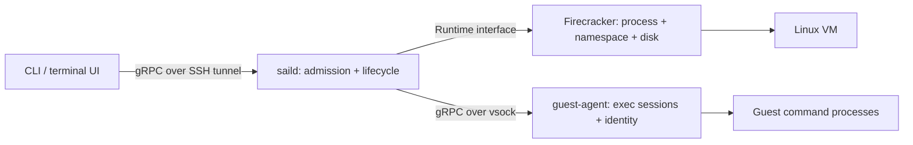

# saild-lite

A small, standalone VM host with saild-shaped gRPC control and exec APIs. It runs
real Linux Firecracker VMs, streams commands, opens interactive shells, and forks
running processes and RAM into a new Sailbox identity. There is no scheduler,
database, registry service, or dependency on Sail infrastructure.

## Quick start

On your workstation install Go 1.25+, Python 3, OpenSSH, and
[just](https://github.com/casey/just). The optional AWS provisioner also needs the
AWS CLI, Pulumi CLI, configured AWS credentials, and a logged-in Pulumi backend.

```sh
git clone git@github.com:sailresearchco/saild-lite.git
cd saild-lite
AWS_PROFILE=your-profile just provision
just tunnel                          # keep running in this terminal
```

`provision` creates a dedicated VPC and Ubuntu EC2 host, waits for cloud-init,
builds the binaries locally, and deploys them. The default is a `c8i.xlarge` in
`us-west-2` with nested virtualization enabled, 80 GiB encrypted storage, and SSH
restricted to your current public IP. It uses no instance IAM role. AWS charges
apply while the host exists.

In another terminal in the same checkout:

```sh
bin/sail create --id parent --cpu 1 --memory 512
bin/sail exec parent -- bash -c 'echo "$SAILBOX_ID"; uname -a'
bin/sail shell parent
bin/sail fork parent child
bin/sail list
bin/sail shell child
bin/sail stop child
bin/sail stop parent
bin/sail tui                         # command prompt for these operations
```

The terminal shell supports stdin, terminal resizing, and control characters.
`exec` streams stdout/stderr and returns the guest exit status. The `tui` command
is a simple command prompt, with `list`, `create`, `shell`, `fork`, `checkpoint`,
`restore`, and `stop`; type `quit` to leave it.

`SAILD_ADDR` or `bin/sail --addr HOST:PORT ...` selects a different forwarded
endpoint. The daemon listens only on host loopback; access is through SSH.

## Edit and redeploy

```sh
# Edit cmd/, internal/, or guest/init, then:
just redeploy
```

This builds and stages the replacement binaries and guest image before stopping
the service. It then stops saild and every VMM in its systemd cgroup, removes its
VM disks, checkpoints, network namespaces and firewall chains, replaces the
binaries and image, and starts with empty CPU/RAM accounting. **All existing
VMs and checkpoints are lost.** Ordinary daemon restarts have the same reset
semantics. The final readiness check calls `GetWorkerState`.

Redeploy patches the guest agent and init script into the cached base image.
Changes to `guest/Dockerfile` require rebuilding the base: stop the service,
remove `/opt/saild-lite/assets/default.ext4` on the host, then run `just bootstrap`.
Firecracker and the kernel are downloaded and SHA-256 checked during bootstrap;
their versions and hashes are in `deploy/artifacts.env`.

## Bring your own host

Provisioning is optional. Use an x86-64 Ubuntu 24.04 host with systemd, working
`/dev/kvm`, internet access, and passwordless sudo. Nested virtualization must be
enabled if this is itself a VM. Other distributions may need bootstrap changes.

```sh
export SAILD_HOST=203.0.113.10         # replace with your host
export SAILD_USER=ubuntu
export SAILD_SSH_KEY="$HOME/.ssh/my-key"
just bootstrap
just tunnel
```

These variables override the generated `artifacts/host.json`. Deploying and
using the daemon require only SSH, not AWS or Pulumi. The provisioner's defaults
can be changed with `AWS_PROFILE`, `AWS_REGION`, `SAILD_STACK`, and
`SAILD_SSH_CIDR`; `infra/Pulumi.yaml` defines the replaceable AWS example.
Configure admission budgets in `/etc/default/saild-lite` with `SAILD_CPUS` and
`SAILD_MEMORY_MIB`, then restart the service. Leave memory for the host and VMMs.

The example host **automatically terminates 24 hours after bootstrap cloud-init**.
This is a transient systemd timer and does not survive a host reboot. To retain
the host, explicitly stop `saild-lite-expiry.timer`. To remove the host and its
remaining cloud resources through Pulumi:

```sh
AWS_PROFILE=your-profile just destroy
```

Auto-termination deletes the instance and its root disk; run `just destroy` to
remove the VPC, security group, and other stack resources too. The generated SSH
key and host information are kept under ignored `artifacts/`; do not commit them.

## Architecture and API



| Surface | Responsibility |
| --- | --- |
| `proto/saild.proto` | Control, streaming exec, and guest control contracts |
| `internal/host` | IDs, CPU/RAM reservations, per-VM lifecycle locks, exec relay |
| `internal/firecracker` | KVM/VMM lifecycle, networking, local images and snapshots |
| `internal/guest` | Process ownership, output replay, stdin, PTYs, identity rebinding |
| `cmd/sail` | CLI and terminal prompt |
| `scripts/`, `deploy/`, `infra/` | SSH deployment, systemd service, optional AWS provisioning |

The RPC names and separation follow production saild. This is a standalone,
reduced contract, **not a drop-in production wire-compatible server**. Control
RPCs start/stop VMs, fork, checkpoint/restore, and report worker state.
`StreamExec` emits Started, Chunk, and Exit frames; separate RPCs write stdin,
resize a PTY, and cancel a process group. The host/runtime and guest boundaries
are explicit so another runtime can implement the same control interface.

Pending starts reserve resources before doing I/O. Expensive work runs outside
the global accounting mutex. A VM's reservation is released after its VMM exits
and its local resources are cleaned up.

### Fork semantics

Fork reserves child capacity, syncs the guest disk, pauses the parent, captures
Firecracker CPU/device state and RAM, copies the disk, and resumes the parent.
It starts a second Firecracker process from that checkpoint with an independent
writable disk and network namespace, then rebinds the guest to its new ID.

Processes keep their PID, RAM, open files, and guest-local sockets. New commands
receive the new `SAILBOX_ID`, and `/run/sailbox-id` and the hostname are updated.
Existing processes retain their inherited environment; code needing the current
identity should read `$SAILBOX_ID_FILE`. External TCP connections and host-to-guest
exec transports are not promised to survive a fork; reconnect to the child.
Snapshots are local to this host and must use compatible VMM/kernel/CPU settings.

```sh
checkpoint=$(bin/sail checkpoint parent)
bin/sail restore "$checkpoint" restored
```

Checkpoint artifacts live until the next reset. Fork's intermediate checkpoint
is deleted after restore. There is no disk quota or checkpoint garbage collector.

Exec processes outlive a disconnected stream. API clients can reattach with the
same `exec_request_id`, empty `argv`, and stdout/stderr sequence cursors. Retention
is bounded to 1 MiB per session and 64 sessions; completed unattached sessions
are evicted as needed. Replay is best-effort when the requested output has aged
out. There is one attached stream per session.

This implementation provides Linux guests only. It has no Windows runtime,
image registry, distributed placement, authentication inside gRPC, durable
accounting, or production hardening. Firecracker runs as root inside a chroot
and network namespace; this is a development host for trusted operators, not a
multi-tenant service. Guest traffic uses NAT; metadata and direct host ingress
are blocked, and there is no inbound guest port publishing.

## Validation and troubleshooting

```sh
just format
just test                           # race-enabled unit and real process/PTY tests
just build
SAILD_ADDR=127.0.0.1:50051 just smoke # requires an empty disposable KVM host
```

The real-host smoke starts a Python process holding a random secret only in RAM,
forks it, and checks the same PID and secret in both VMs. It also checks child
identity, independent disk writes, checkpoint/restore, guest internet access,
streaming exec, termination, and zero accounting. This passed on the provisioned
EC2 nested-KVM host. CI runs local tests and Linux builds; it does not provision
cloud resources or run the KVM smoke automatically.

The deployment smoke was also checked with a live VM and interactive shell:
redeploy ended the VMM and shell, removed all VM/checkpoint files and network
namespaces, reset accounting to zero, and installed the expected binary hash.

```sh
just ssh
sudo journalctl -u saild-lite -n 100 --no-pager
sudo /opt/saild-lite/sail list --json
sudo ls /var/lib/saild-lite/logs       # console logs of terminated VMs
sudo ls /var/lib/saild-lite/vms        # live VM files and console.log
```

Protobuf Go files are checked in. After editing the schema, install Buf and run
`just generate`, then commit the generated changes.
